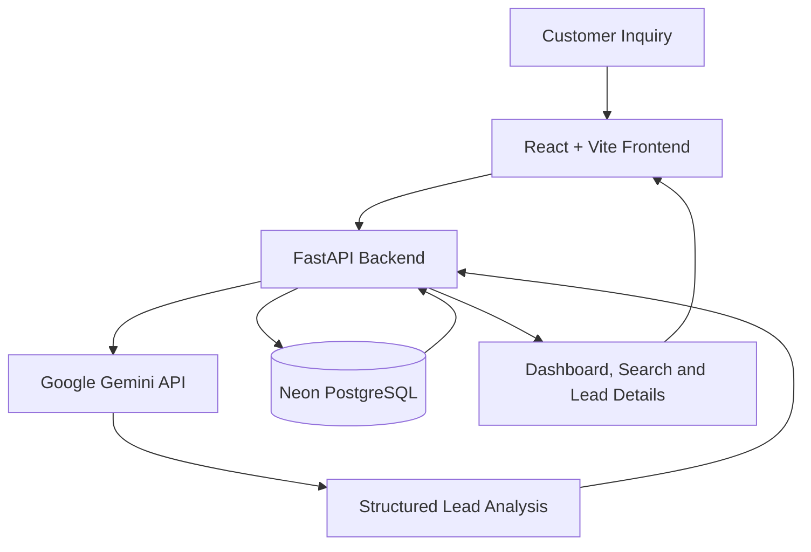
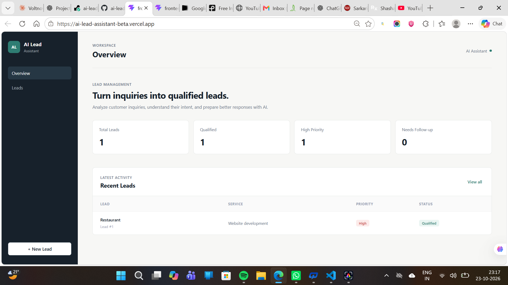
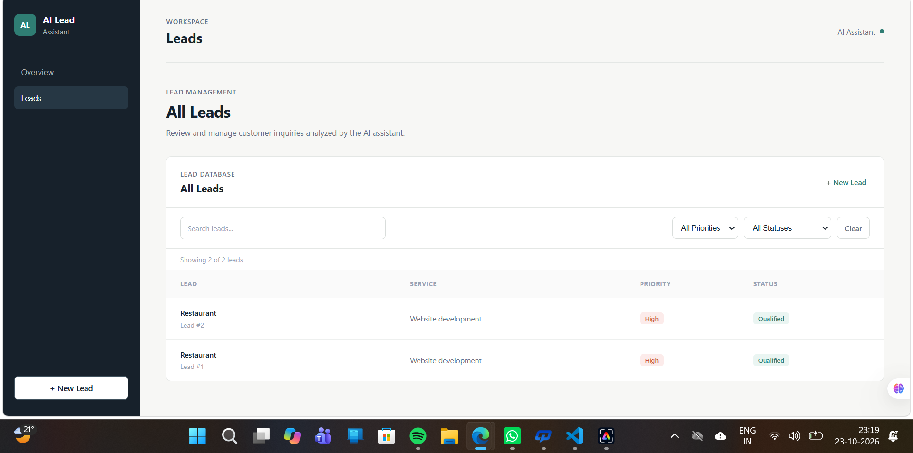
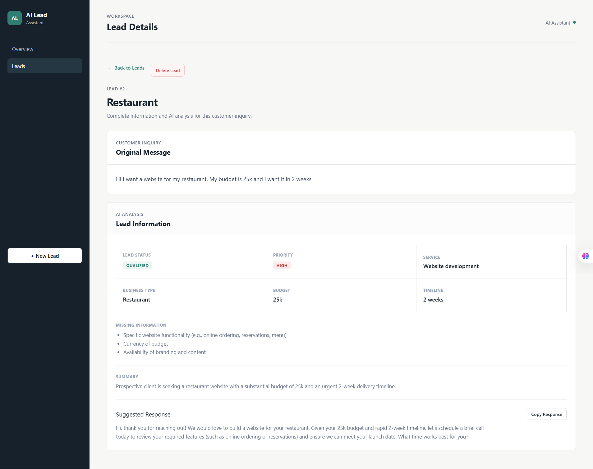

# AI Lead Assistant

A full-stack AI-powered lead qualification application that transforms customer inquiries into structured, actionable lead records using Google Gemini.

**Live Demo:** [AI Lead Assistant](https://ai-lead-assistant-beta.vercel.app/)  
**Backend API:** [FastAPI Backend](https://ai-lead-assistant-api.onrender.com)  
**API Documentation:** [Interactive API Docs](https://ai-lead-assistant-api.onrender.com/docs)  
**Source Code:** [GitHub Repository](https://github.com/ShashankGangwar11/ai-lead-assistant)

## Overview

AI Lead Assistant helps businesses understand incoming customer inquiries by extracting key details, qualifying leads, assigning priorities, identifying missing information, and generating suggested follow-up responses.

The application provides a responsive dashboard where users can review, search, filter, and manage analyzed leads.

## Key Features

- **AI-powered analysis:** Analyze customer inquiries using Google Gemini.
- **Lead qualification:** Classify leads by status and priority.
- **Information extraction:** Identify service requirements, business type, budget, and timeline.
- **Missing information detection:** Highlight details needed to understand a potential customer's requirements.
- **AI-generated summaries:** Turn lengthy inquiries into concise summaries.
- **Suggested responses:** Generate draft replies for customer follow-up.
- **Persistent data storage:** Store production leads in Neon PostgreSQL, with SQLite support for local development.
- **Dashboard statistics:** View total leads, qualified leads, high-priority leads, and follow-up counts.
- **Search and filters:** Find leads by business type, service, or customer message and filter by status or priority.
- **Lead details:** Review the original inquiry and its complete AI analysis.
- **Copy responses:** Copy suggested replies for follow-up.
- **Lead management:** Delete leads with confirmation.
- **Responsive interface:** Use the application on desktop and mobile devices.

## Tech Stack

### Frontend
- React
- Vite
- JavaScript
- CSS

### Backend
- Python
- FastAPI
- Uvicorn
- Google Gemini API
- `google-genai`
- `python-dotenv`

### Database
- Neon PostgreSQL — production database
- SQLite — local development fallback
- `psycopg` — PostgreSQL driver

### Deployment
- Vercel — frontend hosting
- Render — backend hosting
- Neon — managed PostgreSQL database

## Architecture



### How It Works

1. **Input:** The user submits a customer inquiry through the frontend.
2. **Analysis:** The FastAPI backend sends the inquiry to Google Gemini.
3. **Qualification:** The AI extracts lead information, assigns status and priority, identifies missing details, and generates a summary and suggested response.
4. **Storage:** The backend saves the analysis in the configured database.
5. **Review:** The frontend displays saved leads for searching, filtering, and follow-up.

In production, the application uses Neon PostgreSQL. During local development, it can use SQLite when `DATABASE_URL` is not configured.

## What the Assistant Produces

### Lead Information

Extracts the service required, business type, budget, and expected timeline from the customer's message.

### Lead Status and Priority

Classifies the inquiry and assigns a priority to help identify leads that may need attention first.

### Missing Information

Lists additional details that may be useful before moving forward with the lead.

### Summary and Suggested Response

Generates a concise summary of the inquiry and drafts a response that can be copied for customer follow-up.

## Screenshots

### Dashboard
Get a quick overview of total leads, qualified leads, high-priority leads, and recent activity.



### Leads Management
Search, filter, and review saved leads by priority and qualification status.



### Lead Details & AI Analysis
View the original customer inquiry, AI-generated lead qualification, priority, budget, timeline, missing information, summary, and suggested response.


```

## Project Structure

```text
ai-lead-assistant/
├── backend/
│   ├── main.py
│   ├── database.py
│   ├── requirements.txt
│   └── .env                 # Local environment variables; not committed
├── frontend/
│   ├── public/
│   ├── src/
│   │   ├── App.jsx
│   │   ├── App.css
│   │   ├── index.css
│   │   └── main.jsx
│   ├── package.json
│   └── vite.config.js
├── .gitignore
└── README.md
```

The local SQLite database file is generated during development and excluded from Git.

## Run Locally

### Prerequisites

- Python 3.10 or a compatible version
- Node.js and npm
- A Google Gemini API key

### 1. Clone the repository

```bash
git clone https://github.com/ShashankGangwar11/ai-lead-assistant.git
cd ai-lead-assistant
```

### 2. Create and activate a Python virtual environment

On Windows PowerShell:

```powershell
python -m venv venv
.\venv\Scripts\Activate.ps1
```

If PowerShell blocks script execution, use an appropriate local execution-policy setting or activate the environment through your preferred terminal.

### 3. Install backend dependencies

```powershell
cd backend
pip install -r requirements.txt
```

### 4. Configure environment variables

Create a `.env` file inside the `backend/` directory:

```env
GEMINI_API_KEY=your_gemini_api_key
```

For local SQLite development, leave `DATABASE_URL` unset. To use a PostgreSQL database locally, configure `DATABASE_URL` with your own PostgreSQL connection string.

**Never commit API keys or database credentials to GitHub.**

### 5. Start the backend

From the `backend/` directory, run:

```powershell
python -m uvicorn main:app --reload
```

The backend will be available at:

- API: http://127.0.0.1:8000
- Interactive API documentation: http://127.0.0.1:8000/docs

The application initializes its database when the backend starts.

### 6. Start the frontend

Open a second terminal and navigate to the frontend directory from the repository root:

```powershell
cd frontend
npm install
npm run dev
```

Vite will display the local frontend URL, usually:

http://localhost:5173

## Environment Variables

| Variable | Purpose | Required |
|---|---|---|
| `GEMINI_API_KEY` | Authenticates requests to the Google Gemini API | Yes |
| `DATABASE_URL` | PostgreSQL connection string; when configured, the backend uses PostgreSQL instead of SQLite | Only when using PostgreSQL |

In production, configure these variables in the backend hosting service's environment settings rather than committing them to the repository.

## API Endpoints

### Health Check

```http
GET /
```

Returns a message confirming that the backend is running.

### Get Leads

```http
GET /api/leads
```

Returns saved leads, including their AI-generated analysis, ordered by newest first.

### Analyze a Lead

```http
POST /api/analyze-lead
Content-Type: application/json
```

Example request:

```json
{
  "message": "I run a small clothing brand and need social media marketing. My budget is around ₹25,000 per month and I want to start next month."
}
```

The response includes the lead ID and analysis fields such as lead status, priority, service, business type, budget, timeline, missing information, summary, and suggested response. The analyzed lead is saved in the configured database.

### Delete a Lead

```http
DELETE /api/leads/{lead_id}
```

Deletes the specified lead from the database.

## Use Case

A small business can use the application to review incoming inquiries, understand customer requirements, identify missing details, prioritize potential leads, and prepare initial responses without manually organizing every message.

## Future Improvements

- Add editing for saved lead details.
- Implement pagination for larger lead lists.
- Integrate email or WhatsApp follow-ups.
- Add user authentication and shared workspaces.
- Add automated tests and strengthen API error handling.
- Add configurable AI model fallback and retry handling.

## Author

**Shashank Gangwar**

Built as a portfolio project to explore AI-powered lead qualification, API integration, database persistence, and full-stack application development.
